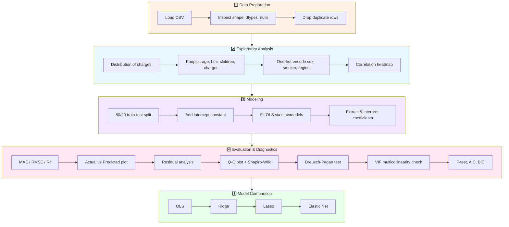
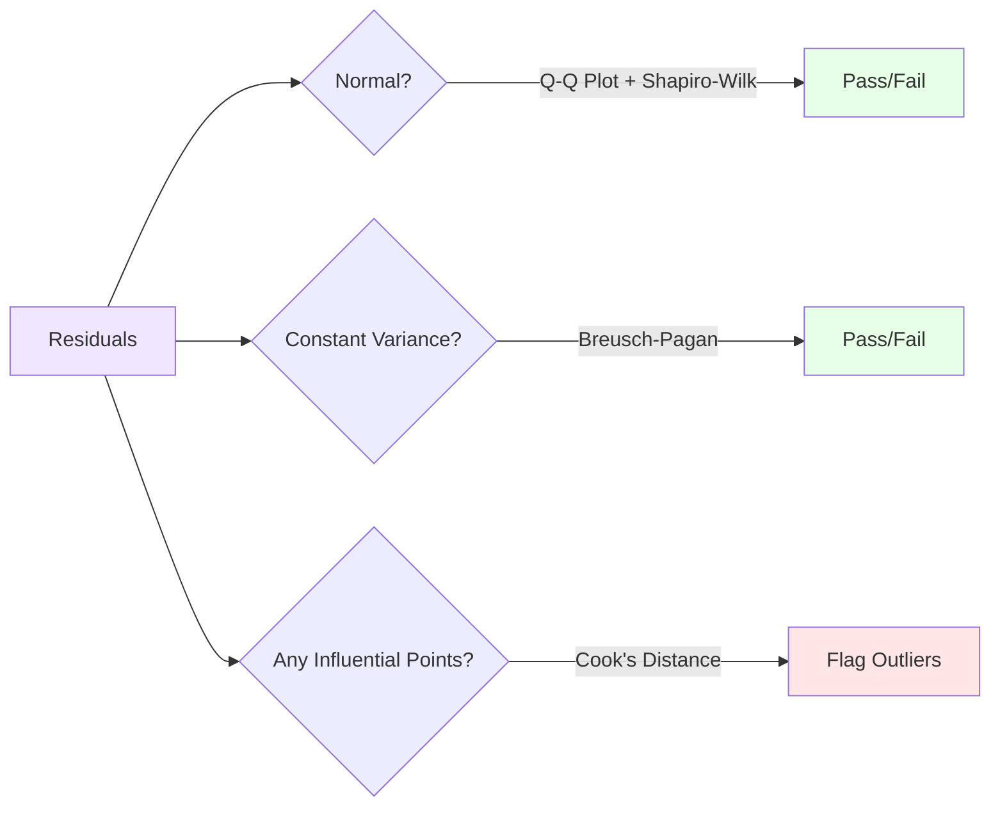

<div align="center">

# 💰 Medical Insurance Charges Prediction

### A rigorous OLS regression project — from raw data to statistically validated model

[](https://www.python.org/)
[](https://www.statsmodels.org/)
[](https://scikit-learn.org/)
[](https://pandas.pydata.org/)
[](#license)

*Predicting medical insurance charges using demographic and lifestyle features — with full regression diagnostics, not just a prediction score.*

</div>

---

## 📋 Table of Contents

- [Overview](#-overview)
- [Dataset](#-dataset)
- [Project Workflow](#-project-workflow)
- [Exploratory Data Analysis](#-exploratory-data-analysis)
- [Model: Ordinary Least Squares (OLS)](#-model-ordinary-least-squares-ols)
- [Regression Diagnostics](#-regression-diagnostics)
- [Model Comparison](#-model-comparison)
- [Results](#-results)
- [Getting Started](#-getting-started)
- [Project Structure](#-project-structure)
- [Diagnostic Checklist Reference](#-diagnostic-checklist-reference)
- [Next Steps](#-next-steps)
- [License](#-license)

---

## 🔍 Overview

This project builds an **Ordinary Least Squares (OLS) regression model** to predict `charges` — the medical insurance cost billed to a patient — based on demographic and lifestyle attributes such as age, BMI, smoking status, and region.

Unlike a typical "fit-and-predict" notebook, this project treats the model **statistically**: every assumption of linear regression (normality, homoscedasticity, multicollinearity, influence) is explicitly tested rather than assumed.


---

## 🗂️ Dataset

The classic **medical insurance cost dataset** — widely used for regression benchmarking.

| Feature | Type | Description |
|---|---|---|
| `age` | Numeric | Age of the primary beneficiary |
| `sex` | Categorical | Gender of the insured (`male` / `female`) |
| `bmi` | Numeric | Body Mass Index |
| `children` | Numeric | Number of dependents covered |
| `smoker` | Categorical | Smoking status (`yes` / `no`) |
| `region` | Categorical | Residential region in the US |
| `charges` | Numeric (Target) | Medical insurance cost billed |

> 🚬 **Spoiler from the literature on this dataset:** smoking status is consistently the single strongest predictor of insurance charges — expect it to dominate the coefficient table.

---

## 🔄 Project Workflow



---

## 📊 Exploratory Data Analysis

The notebook visually inspects the data before modeling:

- **Charges distribution** — histogram with KDE overlay to check skewness
- **Pairplot** across `age`, `bmi`, `children`, `charges` — spots non-linear patterns early
- **Correlation heatmap** on the fully encoded dataset — flags multicollinearity risks before they hit the model

| Visualization | Purpose |
|---|---|
| 📈 Histogram + KDE | Reveals right-skew typical of cost data |
| 🔗 Pairplot | Surfaces relationships between numeric predictors and target |
| 🌡️ Correlation Heatmap | Identifies which features move together |

---

## 📈 Model: Ordinary Least Squares (OLS)

Built with `statsmodels` (not just `sklearn`) specifically because it provides **full statistical inference** — standard errors, p-values, confidence intervals, and F-statistics — not just point predictions.

```python
X_train_sm = sm.add_constant(X_train)
ols_model = sm.OLS(y_train, X_train_sm)
ols_results = ols_model.fit()
```

**Coefficient table includes:**
- Coefficient estimate
- Standard error
- t-value
- p-value
- 95% confidence interval (lower & upper bounds)

---

## 🩺 Regression Diagnostics

This is what separates this project from a basic regression script — **every core OLS assumption is explicitly tested**:

| Diagnostic | Test Used | What It Checks |
|---|---|---|
| **Normality of residuals** | Q-Q plot + Shapiro-Wilk test | Are residuals normally distributed? |
| **Homoscedasticity** | Breusch-Pagan test + Residuals-vs-Predicted plot | Is error variance constant across predictions? |
| **Multicollinearity** | Variance Inflation Factor (VIF) | Are predictors too correlated with each other? |
| **Outliers/Influence** | Cook's Distance | Are any observations disproportionately affecting the model? |
| **Overall significance** | F-test | Is the model as a whole statistically significant? |
| **Model comparison** | AIC / BIC | Which model best balances fit and complexity? |



---

## ⚖️ Model Comparison

To check whether regularization improves generalization, the notebook benchmarks OLS against three regularized alternatives:

| Model | Regularization Type | Purpose |
|---|---|---|
| **OLS (Linear Regression)** | None | Baseline — unbiased but sensitive to multicollinearity |
| **Ridge** | L2 | Shrinks coefficients, handles multicollinearity |
| **Lasso** | L1 | Shrinks *and* can zero out weak predictors (feature selection) |
| **Elastic Net** | L1 + L2 | Balances Ridge's stability and Lasso's sparsity |

Each model is compared on **MAE**, **RMSE**, and **R²**, with bar charts visualizing error and accuracy side by side.

---

## 🎯 Results

| Metric | Value | Interpretation |
|---|---|---|
| **MAE** | 4177.05 | On average, predictions are off by ~$4,177 |
| **RMSE** | 5956.34 | Higher than MAE → some larger errors exist (outlier sensitivity) |
| **R²** | 0.8069 | Model explains ~80.7% of the variation in insurance charges |

> 📌 A strong result for a simple linear model — but the RMSE > MAE gap signals the presence of high-cost outliers (likely smokers with high BMI) that the model doesn't fully capture.

---

## 🚀 Getting Started

### Prerequisites

```bash
pip install pandas numpy matplotlib seaborn statsmodels scikit-learn scipy
```

### Run the notebook

```bash
git clone https://github.com/<your-username>/insurance-charges-regression.git
cd insurance-charges-regression
jupyter notebook insurance_ml.ipynb
```

> 📁 Update the `pd.read_csv(...)` path in the first cell to point to your local copy of `insurance.csv`.

---

## 📁 Project Structure

```
insurance-charges-regression/
├── insurance_ml.ipynb          # Main notebook — EDA → OLS → diagnostics → comparison
├── data/
│   └── insurance.csv
├── ols_predictions.csv         # Exported actual vs. predicted vs. residual table
├── README.md                   # You are here
└── requirements.txt
```

---

## ✅ Diagnostic Checklist Reference

| Check | Purpose |
|---|---|
| R² | Model explanatory power |
| Adjusted R² | Penalizes unnecessary predictors |
| MAE | Average prediction error |
| RMSE | Penalizes large errors |
| Actual vs Predicted | Prediction quality |
| Residual distribution | Error behavior |
| Residual vs Predicted | Linearity + variance patterns |
| Q-Q plot | Residual normality |
| Shapiro-Wilk test | Statistical normality check |
| Breusch-Pagan | Constant variance |
| VIF | Multicollinearity |
| Cook's Distance | Influential observations |
| p-values | Individual coefficient significance |
| Confidence intervals | Coefficient uncertainty |
| F-test | Overall model significance |
| AIC/BIC | Model comparison |

---

## 🔮 Next Steps

- [ ] Apply a log-transform to `charges` to address right-skew and re-test residual normality
- [ ] Engineer an interaction term (`smoker × bmi`) — smoking's cost impact likely compounds with high BMI
- [ ] Try a tree-based model (Random Forest / Gradient Boosting) to capture non-linear effects
- [ ] Cross-validate regularization strength (`alpha`) for Ridge/Lasso instead of using fixed values
- [ ] Deploy the final pipeline behind a simple charges-estimator API

---

## 📄 License

This project is licensed under the MIT License — free to use for educational and research purposes.

<div align="center">

---

**⭐ If this project helped you understand regression diagnostics, consider starring the repo!**

</div>

Author-mamta bisht

